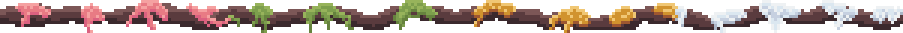
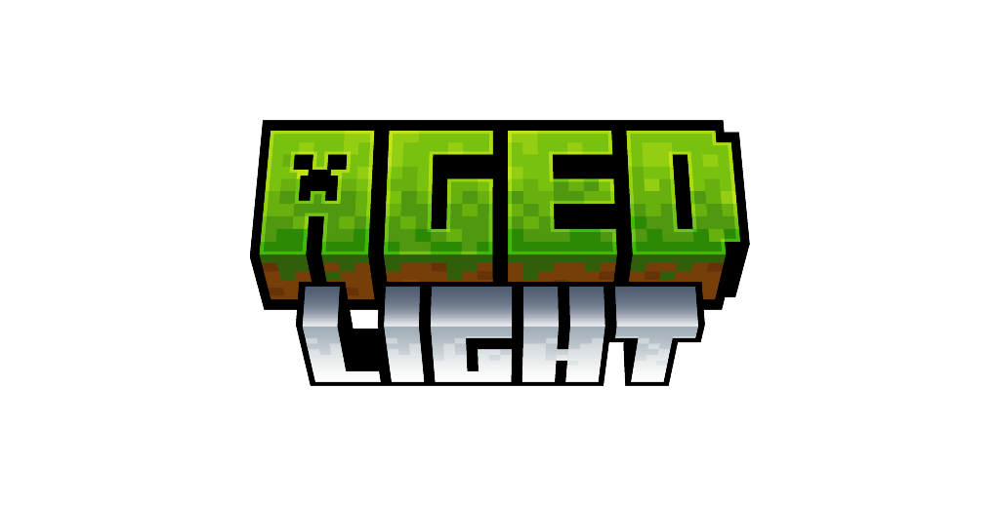

# Aged Light

**Performance-optimized survival without compromise.**

Aged Light is the lightweight edition of the [Aged modpack](https://modrinth.com/modpack/aged). Designed specifically for players with lower-end hardware or those who prefer a *"vanilla-plus"* visual style. This version removes heavy client-side aesthetic mods while keeping every single core gameplay mechanic intact.

### The "Light" Advantage
- **High Performance:** Stripped of heavy shaders, complex particle effects, and demanding animations.
- **Faster Load Times:** Less mods, resourcepacks, shaders -> lower (RAM) usage.
- **Full Compatibility:** Join any server running 'Aged' or 'Aged Light'. *All gameplay mods are identical, only the visuals have been trimmed.*

Whether you are playing on a high-end rig or a potato laptop, you can survive together. **Aged Light is compatible with the standard [Aged modpack](https://modrinth.com/modpack/aged).**

### Aged Features

- 📜 **Quests:** A streamlined quest line to help you navigate the world and determine what to acquire next.
- 🧮 **Character Leveling:** Earn XP to level up your skills and unlock the ability to craft and use higher-tier equipment.
- 🛠️ **Jobs:** Choose specific professions to accelerate your XP gain and specialize your role within a community.
- 💧 **Hydration:** Manage your thirst with clean, filtered water. Drinking from stagnant sources leads to illness and dehydration.
- 🍖 **Nutrition** Maintain a balanced diet to gain powerful buffs. If you ignore nutritional variety, you will suffer from debuffs.
- 🌡️ **Temperature:** Adapt to the climate by seeking heat in the winter and shade in the summer. Extreme exposure can be fatal.
- 🌸 **Seasons:** Dynamic weather patterns and seasonal changes directly impact crop growth and world traversal.
- 🪨 **Geological Material Progression:** Navigate distinct stone layers, each with unique hardness and specific harvest level requirements.
- ⛏️ **Material Progression:** A deep progression path starting from flint to copper, bronze, iron, & basic steel -> *and that’s only the beginning.*
- 🛞 **Mechanics:** Master complex systems involving redstone mechanisms, wheels, gears, and the effects of oxidization.
- 💥 **Advanced Machinery:** Engineer powerful forgeries, flying vehicles, controlled machines, submarines and more.
- 🧹 **Archeology:** Unearth ancient fossils, forgotten relics, and powerful enchantments buried in the earth.
- ✨ **Decorate:** Express yourself with massive interior block sets, new wood palettes, and expanded stone varieties.

*A challenging medieval based modpack where realism & wisdom rule your life.*

You awaken in the wilderness.
You quickly realize that you need to **gather supplies** & craft some **flint tools**.
**Fresh water** and **body temperature** become important pretty soon.
Your **character** is still weak, so you go an adventure to **gather experience** to increase your **skills and attributes**.

*That's where your story begins.*

<strong>
Features
</strong>

- 💧 **Hydration** - boil water to receive purified water that you can safely consume
- 🍖 **Nutrition** - eat a balanced diet, but don't eat spoiled dishes
- ❄️ **Temperature** - keep yourself cozy in all areas
- 🌍 **Seasons** - prepare for winter & check your crops
- 🧮 **Skills** - gather xp to improve your characters aspects
- 🛠️ **Jobs** - assign up to 2 jobs to receive xp faster
- 🏡 **Settle** - explore & protect your goods against enemy forces
- 🪙 **Trade** - you'll stumple upon more wandering traders & other traders
- ⚔️ **Fight** - mobs get stronger the further you go. At the same time they offer more loot
- ♟️ **Bosses** - more than 6 unique boss fights to defeat
- 🎒 **Backpacks** - store goods in drawers or use portable backpacks
- 📦 **Sieve** - filter items trough sieves to get common to rare items
- 🪑 **Furniture** - decorate your home with a variety of furniture blocks
- 🦖 **Archeology** - reveal ancient fossils & powerful enchantments
- ✨ **Decorate** - various blocks to decorate with

<strong>
Different Versions
</strong>

You're most likely asking yourself what the differences between [Aged Light](https://modrinth.com/modpack/aged-light) & [Aged](https://modrinth.com/modpack/aged) are.  
**Aged Light is a lightweight version of Aged with close to 0 aesthetic & visual mods.**

Since Aged v3.1.0 both modpacks are compatible with each other.  
Take a look at the [Aged Light Changelog](https://raw.githubusercontent.com/xR4YM0ND/Aged-Light/refs/heads/1.21.1/CHANGELOG.md) to know which Aged version its compatible with.

  
  

In this repo you will only see files specific to aged-light (without client side enhancements).

Mods which are in Aged-Light

- List all mods here

<strong>
FAQ
</strong>

> **Q: Does Aged support multiplayer?**
>
> **A**: Yes and No, Aged is build for singleplayer since v3.0.0 but can be downloaded as server file via e.g. [ATLauncher](https://atlauncher.com/downloads) / [mrpack-install](https://github.com/nothub/mrpack-install#readme) / [docker](https://github.com/itzg/docker-minecraft-server).
>
> If you want to play with a friend we recommend to use [e4mc](https://modrinth.com/mod/e4mc) to create a server for free.

> **Q: Is there a wiki or documentation?**
>
> **A**: Ingame you'll find a guide book at first start.  
> Combine a book with a sapling/seed or use `/give @s agedaddition:guide_book`

> **Q: Where to ask for help / bug report?**
>
> **A**: For **questions** ask in `modpack-chat` on our [Discord](https://discord.gg/WXdSYn4yHB). For **bugs** pls open a [github issue](https://github.com/xR4YM0ND/Aged-Light/issues).

<strong>
Known Bugs
</strong>

> **To be filled**
>
> New verison 4.0.0 -> waiting for your feedback ^^
